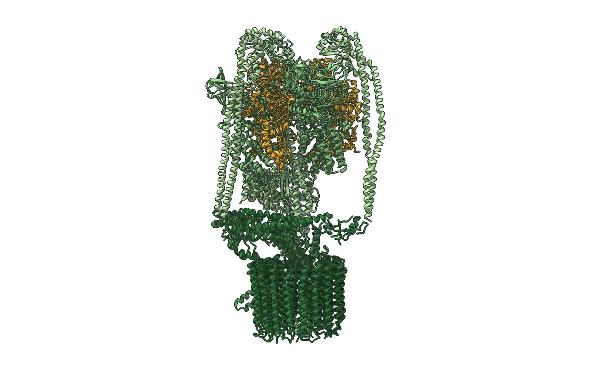
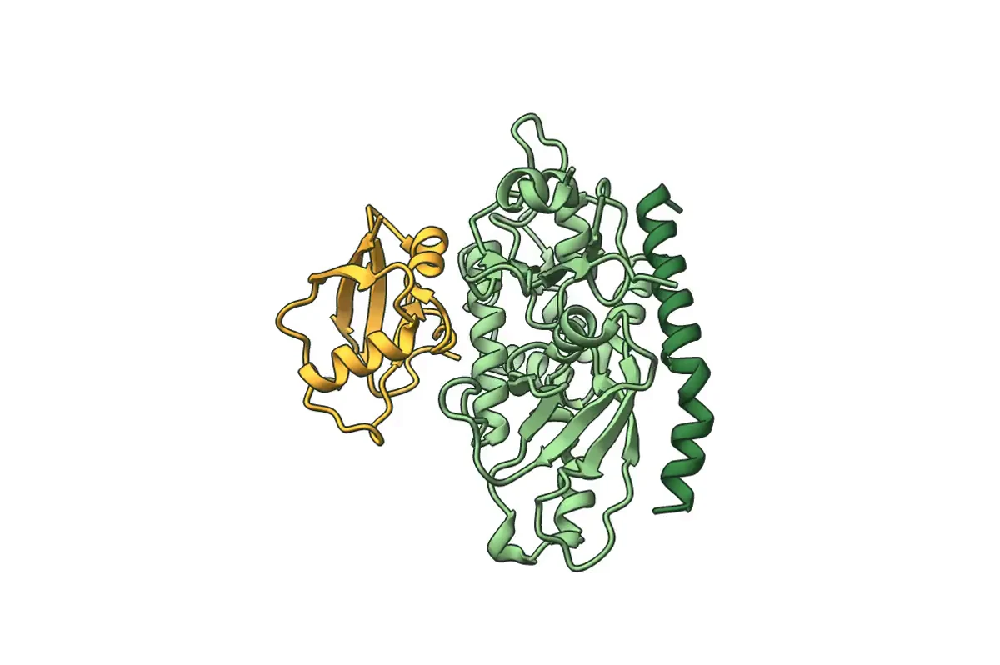

# Tonoplast scenes

Python-scripted Blender scenes of membrane biology at the plant vacuole, built with
[Molecular Nodes](https://github.com/BradyAJohnston/MolecularNodes) from public structures.
Every scene is generated from code, so it can be re-rendered, re-timed or re-coloured
without touching the Blender UI.

The first scene shows the **plant V-ATPase** standing in the tonoplast, with
**ATG12–ATG5–ATG16 complexes** moving in the cytosol beside its V1 head: the proton pump
of the vacuolar membrane and the machinery that attaches ATG8 to membranes.

| V-ATPase · PDB 7UWA | ATG12–ATG5–ATG16 · PDB 4GDK |
| --- | --- |
|  |  |

<sub>Reference views of the two structures, rendered in ChimeraX.</sub>

## What the scene does

- **Membrane:** a lightly rippled tonoplast covered with about 5,000 individual phospholipids,
  each aligned to the surface normal.
- **Structures:** loaded from `structures/` and drawn as atomic spheres, tinted per protein
  while keeping per-element colour variation.
- **Motion:** the ATG16 complexes drift along closed paths with Brownian-like rotation, the
  camera sways around the pump, and every animation curve returns to its start, so the
  6-second video loops seamlessly.
- **Look:** WEHI-style lighting (one warm key, weak cool fill and rim), molecular crowding
  in the cytosol, depth of field, and a compositor pass with glow, colour balance and
  vignette.

## Run it

Requirements: Blender 4.2 or newer with the Molecular Nodes extension installed.

```bash
# one still frame, written to output/
blender --background --python scenes/vatpase_atg16.py -- --render-still 1

# the full loop as an MP4
blender --background --python scenes/vatpase_atg16.py -- --render

# or in chunks, then join the frames
blender --background --python scenes/vatpase_atg16.py -- --render-frames 1 72
blender --background --python scenes/vatpase_atg16.py -- --render-frames 73 144
blender --background --python scenes/vatpase_atg16.py -- --encode
```

## Structures

`structures/` already contains the two prepared files. To rebuild them from the PDB:

```bash
chimerax --nogui --script tools/prepare_structures.py
```

- `vatpase_up.cif`: citrus V-ATPase ([PDB 7UWA](https://www.rcsb.org/structure/7UWA),
  Tan et al., *Structure* 2022), rotated so the axis from the V0 c-ring to the V1 head points
  along +z, with the c-ring at the origin. The membrane can then sit at z = 0.
- `atg16_complex.cif`: human ATG12–ATG5–ATG16N
  ([PDB 4GDK](https://www.rcsb.org/structure/4GDK), chains A–C), centred.

## Layout

```
scenes/
  common.py            scene reset, materials, lipid bilayer, crowding, lighting, rendering
  vatpase_atg16.py     the V-ATPase / ATG16 scene
structures/            prepared mmCIF files
tools/
  prepare_structures.py   ChimeraX script that writes structures/
docs/                  images used in this README
```

## Author

Alvar Pascual García, biotechnologist (MSc, BOKU Vienna) ·
[alvar56.github.io](https://alvar56.github.io)
